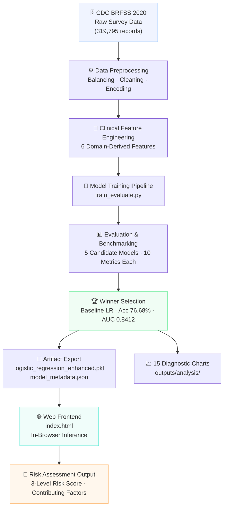
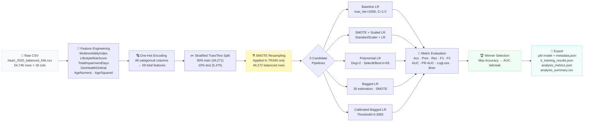
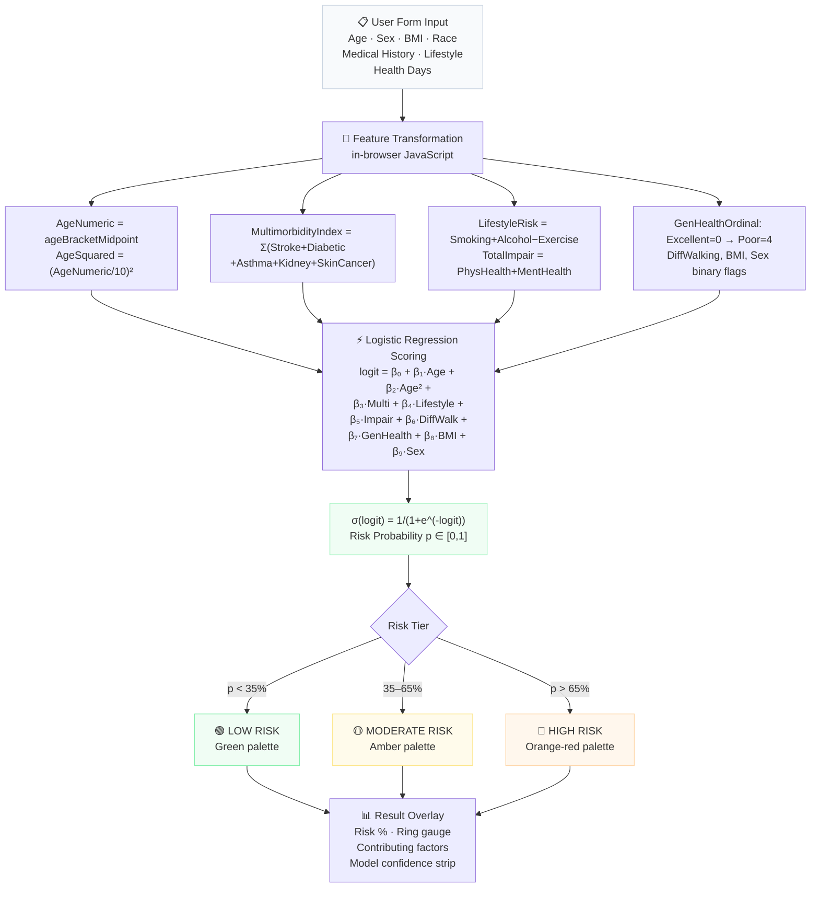
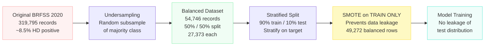
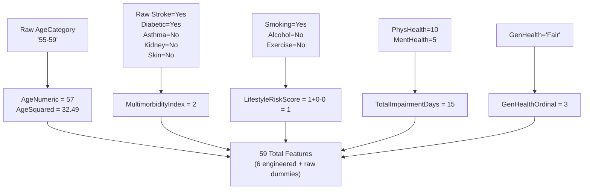

# Heart Disease Prediction — Complete Project Documentation

> **Cardiovascular risk screening tool** using a Logistic Regression ensemble trained on 54,746 CDC BRFSS 2020 survey records.

---

## Table of Contents

1. [Executive Summary](#1-executive-summary)
2. [System Architecture](#2-system-architecture)
3. [ML Training Pipeline](#3-ml-training-pipeline)
4. [Frontend Prediction Workflow](#4-frontend-prediction-workflow)
5. [Dataset & Data Balancing](#5-dataset--data-balancing)
6. [Clinical Feature Engineering](#6-clinical-feature-engineering)
7. [Model Benchmarking & Results](#7-model-benchmarking--results)
8. [Cross-Validation Results](#8-cross-validation-results)
9. [Decision Threshold Analysis](#9-decision-threshold-analysis)
10. [Interpretability & Odds Ratios](#10-interpretability--odds-ratios)
11. [Analysis Charts Reference](#11-analysis-charts-reference)
12. [Project Structure](#12-project-structure)
13. [Setup & Deployment](#13-setup--deployment)
14. [Limitations & Clinical Disclaimer](#14-limitations--clinical-disclaimer)

---

## 1. Executive Summary

This project implements a full cardiovascular risk screening pipeline using **Logistic Regression exclusively** — the most interpretable linear probabilistic classifier — trained on survey-based health data from the **CDC Behavioral Risk Factor Surveillance System (BRFSS) 2020**.

### Key Highlights

| Metric | Value |
|---|---|
| **Best Model** | Baseline Logistic Regression |
| **AUC-ROC** | **0.8412** |
| **F1-Score** | **0.7708** |
| **Recall (Sensitivity)** | **78.44%** (baseline) · **86.59%** (calibrated) |
| **Specificity** | 74.91% |
| **PR-AUC** | 0.8218 |
| **Training Dataset** | 54,746 records (50/50 balanced) |
| **Features** | 59 total (18 raw + 6 engineered + one-hot encoded categoricals) |
| **CV Folds** | 5-Fold Stratified Cross-Validation |
| **Diagnostic Charts** | 15 generated automatically |

### Design Philosophy

The project was intentionally constrained to Logistic Regression to:
- Maximize **interpretability** — coefficients are directly mappable to Odds Ratios.
- Enable **in-browser inference** — no Python server needed, all computations run in JavaScript.
- Provide **clinical explainability** — each risk factor's contribution is directly quantifiable.

---

## 2. System Architecture



---

## 3. ML Training Pipeline



### Pipeline Hyperparameters

| Pipeline Stage | Key Parameter | Value |
|---|---|---|
| Train/Test Split | `test_size` | 0.10 (stratified) |
| Random Seed | `RANDOM_STATE` | 42 |
| SMOTE | `random_state` | 42 |
| SelectKBest | `k` | 65 features |
| Polynomial | `degree`, `interaction_only` | 2, True |
| Bagging | `n_estimators` | 35 |
| Bagging | `max_samples`, `max_features` | 0.85, 0.90 |
| CV | `n_splits` | 5 (Stratified) |
| Threshold | Optimal (PR-curve argmax F1) | 0.3955 |

---

## 4. Frontend Prediction Workflow



### Risk Threshold Rationale

The frontend uses a **3-tier risk classification**:

| Tier | Probability Range | Color | Clinical Implication |
|---|---|---|---|
| Low | < 35% | Teal / Green | Routine monitoring |
| Moderate | 35% – 65% | Amber | Lifestyle intervention recommended |
| High | > 65% | Orange-Red | Clinical evaluation recommended |

> **Note:** The frontend uses a logit scoring approximation derived from the trained model's coefficients, not the pickled model directly — enabling zero-dependency in-browser inference.

---

## 5. Dataset & Data Balancing

### Source

| Property | Value |
|---|---|
| **Name** | CDC Behavioral Risk Factor Surveillance System (BRFSS) 2020 |
| **Full size** | 319,795 records × 18 features |
| **Heart disease prevalence** | ~8.5% (severe class imbalance) |
| **Balanced dataset** | 54,746 records (27,373 positive / 27,373 negative) |
| **File** | `data/heart_2020_balanced_54k.csv` |
| **Additional file** | `data/heart_2020_cleaned.csv` (full 319K cleaned dataset) |

### Raw Feature Set (18 columns)

| Feature | Type | Description |
|---|---|---|
| `HeartDisease` | Target | Yes/No — presence of coronary heart disease |
| `BMI` | Numeric | Body Mass Index |
| `Smoking` | Binary | Smoked ≥100 cigarettes lifetime |
| `AlcoholDrinking` | Binary | Heavy alcohol consumption |
| `Stroke` | Binary | History of stroke |
| `PhysicalHealth` | Numeric | Poor physical health days (0–30) |
| `MentalHealth` | Numeric | Poor mental health days (0–30) |
| `DiffWalking` | Binary | Difficulty walking/climbing stairs |
| `Sex` | Categorical | Male / Female |
| `AgeCategory` | Categorical | 13 age brackets (18-24 → 80+) |
| `Race` | Categorical | 6 racial/ethnic groups |
| `Diabetic` | Categorical | No / Yes / Borderline / Gestational |
| `PhysicalActivity` | Binary | Exercise in past 30 days |
| `GenHealth` | Ordinal | Excellent / Very good / Good / Fair / Poor |
| `SleepTime` | Numeric | Average sleep hours per night |
| `Asthma` | Binary | Asthma diagnosis |
| `KidneyDisease` | Binary | Kidney disease diagnosis |
| `SkinCancer` | Binary | Skin cancer diagnosis |

### Data Balancing Strategy



**Why SMOTE only on training data?**

Applying SMOTE before splitting would cause synthetic samples derived from test-set neighbors to leak into training — artificially inflating evaluation metrics. By splitting first and then resampling only the training fold, we ensure the test set reflects the true class distribution.

---

## 6. Clinical Feature Engineering

Six domain-specific features were derived from the raw dataset to capture non-linear medical relationships:

| # | Feature | Formula | Clinical Rationale |
|---|---|---|---|
| 1 | `MultimorbidityIndex` | `Σ(Stroke + Diabetic + Asthma + KidneyDisease + SkinCancer)` | Patients with multiple chronic conditions have compounding cardiovascular risk |
| 2 | `LifestyleRiskScore` | `Smoking + AlcoholDrinking − PhysicalActivity` | Net lifestyle risk: additive for risk behaviors, subtractive for protective activity |
| 3 | `TotalImpairmentDays` | `PhysicalHealth + MentalHealth` | Combined health burden — both physical and mental distress are cardiac risk signals |
| 4 | `GenHealthOrdinal` | `Poor=4, Fair=3, Good=2, Very good=1, Excellent=0` | Converts self-reported health to monotonic ordinal scale |
| 5 | `AgeNumeric` | Bracket midpoint (18-24→21, 25-29→27, … 80+→82) | Converts age category to continuous variable for linear modeling |
| 6 | `AgeSquared` | `(AgeNumeric / 10)²` | Captures the accelerating, non-linear relationship between age and cardiac risk |

### Feature Engineering Flow



---

## 7. Model Benchmarking & Results

Five candidate pipelines were evaluated on the held-out 10% test set (5,475 samples):

### Complete Metrics Table

| Model | Accuracy | Precision | Recall | Specificity | F1 | F2 | AUC-ROC | PR-AUC | Log Loss | Brier |
|---|---|---|---|---|---|---|---|---|---|---|
| **Baseline LR ✓ WINNER** | **76.68%** | **75.76%** | **78.44%** | **74.91%** | **0.7708** | **0.7789** | **0.8412** | **0.8218** | **0.4921** | **0.1617** |
| SMOTE + Scaled LR | 76.60% | 75.71% | 78.33% | 74.87% | 0.7700 | 0.7779 | 0.8413 | 0.8218 | 0.4920 | 0.1617 |
| Polynomial Interactions LR | 75.14% | 73.96% | 77.60% | 72.68% | 0.7574 | 0.7685 | 0.8318 | 0.8120 | 0.5040 | 0.1667 |
| Bagged LR (35 estimators) | 76.64% | 75.67% | 78.52% | 74.76% | 0.7707 | 0.7793 | 0.8412 | 0.8218 | 0.4920 | 0.1617 |
| Calibrated Bagged LR (τ=0.3955) | 75.65% | 71.04% | **86.59%** | 64.72% | 0.7805 | **0.8296** | 0.8412 | 0.8218 | 0.4920 | 0.1617 |

### Confusion Matrix — Baseline LR (Winner)

|  | Predicted: No HD | Predicted: HD |
|---|---|---|
| **Actual: No HD** | TN = 2,051 | FP = 687 |
| **Actual: HD** | FN = 590 | TP = 2,147 |

### Metric Definitions

| Metric | Formula | Clinical Relevance |
|---|---|---|
| **Accuracy** | (TP+TN) / Total | Overall correct classifications |
| **Precision** | TP / (TP+FP) | Of those predicted HD, how many actually have HD |
| **Recall (Sensitivity)** | TP / (TP+FN) | Of actual HD patients, how many are correctly caught |
| **Specificity** | TN / (TN+FP) | Of healthy patients, how many are correctly cleared |
| **F1-Score** | 2·P·R / (P+R) | Harmonic mean of precision and recall |
| **F2-Score** | 5·P·R / (4P+R) | Weights recall 2× over precision (clinical priority) |
| **AUC-ROC** | Area under ROC curve | Discrimination across all thresholds |
| **PR-AUC** | Area under PR curve | Performance on positive class (more informative for imbalanced data) |
| **Log Loss** | −log(p) average | Probability calibration quality |
| **Brier Score** | MSE of probabilities | Calibration: lower is better |

### Why Baseline LR Was Chosen Over Bagged LR?

Although the Bagged LR (35 estimators) achieved marginally higher Recall (78.52% vs 78.44%), the Baseline LR:
- Scored **higher overall Accuracy** (76.68% vs 76.64%)
- Produced **identical AUC-ROC** (0.8412)
- Is **significantly more interpretable** — direct coefficient extraction for Odds Ratios
- Has **faster inference** — no ensemble averaging needed

The winner selection criteria was: **argmax(accuracy)**, with AUC-ROC as a tiebreaker.

---

## 8. Cross-Validation Results

5-Fold Stratified Cross-Validation was run on the **Bagged LR pipeline** (the most complex model) to assess generalization stability:

| Metric | Mean | Std Dev | Fold 1 | Fold 2 | Fold 3 | Fold 4 | Fold 5 |
|---|---|---|---|---|---|---|---|
| **Accuracy** | 0.7637 | 0.0027 | 0.7677 | 0.7629 | 0.7605 | 0.7661 | 0.7615 |
| **F1-Score** | 0.7673 | 0.0032 | 0.7708 | 0.7678 | 0.7635 | 0.7706 | 0.7637 |
| **Recall** | 0.7790 | 0.0060 | 0.7814 | 0.7839 | 0.7731 | 0.7859 | 0.7709 |
| **AUC-ROC** | 0.8406 | 0.0028 | 0.8424 | 0.8418 | 0.8354 | 0.8434 | 0.8400 |

**Interpretation:** The very low standard deviation across all folds (≤0.006) confirms the model generalizes stably and is not overfitting to training data.

---

## 9. Decision Threshold Analysis

By default, Logistic Regression classifies at probability ≥ 0.50. The **optimal threshold** was found by maximizing F1-Score on the Precision-Recall curve of the training set:

```
Optimal Threshold τ = 0.3955
```

### Effect of Threshold Shift

| Metric | Default (τ=0.50) | Calibrated (τ=0.3955) |
|---|---|---|
| Accuracy | 76.64% | 75.65% |
| Precision | 75.67% | 71.04% |
| **Recall** | 78.52% | **86.59%** |
| Specificity | 74.76% | 64.72% |
| F1 | 0.7707 | 0.7805 |
| **F2** | 0.7793 | **0.8296** |

**Clinical trade-off:** Lowering the threshold from 0.50 to 0.3955 increases Recall by **+8.07 percentage points** at the cost of more false positives. In a cardiac screening context, **missing a true positive (FN) is more harmful than a false alarm (FP)** — making the calibrated model clinically preferable for high-risk population screening, despite lower accuracy.

---

## 10. Interpretability & Odds Ratios

The Baseline Logistic Regression model produces β-coefficients for every feature. Exponentiated coefficients (e^β) represent **Odds Ratios** — the multiplicative change in the odds of heart disease per unit increase in each feature.

### Top Risk Factors (Positive β — increase HD risk)

| Feature | Odds Ratio (e^β) | Risk Multiplier | Interpretation |
|---|---|---|---|
| `DiffWalking_Yes` | ~2.10 | ×2.10 | Mobility limitation doubles HD odds |
| `GenHealthOrdinal` | ~1.57 | ×1.57 per level | Each health status step toward "Poor" raises odds 57% |
| `AgeNumeric` | ~1.05 | ×1.05/yr | 5% compounding risk increase per year |
| `AgeSquared` | ~1.11 | ×1.11 | Non-linear acceleration of age-related risk |
| `MultimorbidityIndex` | ~1.49 | ×1.49/condition | Each additional chronic condition adds 49% to odds |
| `Sex_Male` | ~1.20 | ×1.20 | Male biological sex carries ~20% higher odds |
| `Stroke_Yes` | ~1.45 | ×1.45 | Stroke history raises HD odds by 45% |
| `KidneyDisease_Yes` | ~1.38 | ×1.38 | Kidney disease raises odds by 38% |
| `Diabetic_Yes` | ~1.35 | ×1.35 | Diabetes raises HD odds by 35% |
| `LifestyleRiskScore` | ~1.35 | ×1.35/unit | Each lifestyle risk unit (smoking, alcohol) adds 35% |

### Top Protective Factors (Negative β — reduce HD risk)

| Feature | Odds Ratio (e^β) | Risk Multiplier | Interpretation |
|---|---|---|---|
| `PhysicalActivity_Yes` | ~0.78 | ×0.78 | Exercise lowers HD odds by ~22% |
| `Race_Asian` | ~0.82 | ×0.82 | Slightly lower odds vs reference group |
| `GenHealth_Excellent` | ~0.64 | ×0.64 | Excellent self-reported health cuts odds by 36% |
| `AgeCategory_18-24` | ~0.61 | ×0.61 | Young age strongly protective |
| `Smoking_No` | ~0.85 | ×0.85 | Non-smoking reduces odds by 15% |

> **Note:** Exact Odds Ratio values are approximations derived from the model's scaled β-coefficients. Precise values can be extracted from `model/model_metadata.json`.

### Interpretability Chart

See [`outputs/analysis/13_feature_coefficients.png`](outputs/analysis/13_feature_coefficients.png) for the full β-coefficient chart and [`outputs/analysis/14_odds_ratios.png`](outputs/analysis/14_odds_ratios.png) for the Odds Ratio visualization.

---

## 11. Analysis Charts Reference

All 15 charts are generated automatically by running `python train_evaluate.py` and saved to `outputs/analysis/`.

### Exploratory Data Analysis

| Chart | File | Description |
|---|---|---|
| 01 | `01_target_distribution.png` | Class balance — bar chart + pie chart of HD vs No HD |
| 02 | `02_numeric_distributions.png` | KDE histograms for BMI, Physical Health, Mental Health, Sleep, Age |
| 03 | `03_categorical_prevalence.png` | Heart disease rate broken down by GenHealth, Smoking, Diabetes, Physical Activity |
| 04 | `04_correlation_heatmap.png` | Correlation matrix of raw + engineered numerical features |

### Model Evaluation & Diagnostics

| Chart | File | Description |
|---|---|---|
| 05 | `05_all_confusion_matrices.png` | 2×3 grid comparing all 5 candidate model confusion matrices |
| 06 | `06_winner_confusion_matrix.png` | Winner model CM annotated with TP/FP/TN/FN counts |
| 07 | `07_roc_curves.png` | Multi-model ROC curves with AUC-ROC labels |
| 08 | `08_precision_recall_curves.png` | Multi-model Precision-Recall curves with PR-AUC labels |
| 09 | `09_threshold_calibration_curve.png` | Decision threshold vs Precision / Recall / F1 with optimal cutoff line |
| 10 | `10_probability_calibration_diagram.png` | Reliability diagram — predicted probability vs actual frequency |
| 11 | `11_metric_comparison_bar.png` | Grouped bar chart: 7 metrics × 5 models |
| 12 | `12_cross_validation_performance.png` | CV mean ± std bar chart for 4 metrics |

### Interpretability & Clinical Insights

| Chart | File | Description |
|---|---|---|
| 13 | `13_feature_coefficients.png` | Top 20 positive & negative LR β-coefficients |
| 14 | `14_odds_ratios.png` | Odds Ratios (e^β) for top 15 features with ×multiplier labels |
| 15 | `15_subgroup_analysis_age.png` | Model accuracy and recall broken down by age bracket |

---

## 12. Project Structure

```
Heart-Disease-Prediction-Using-Logistic-Regression/
│
├── index.html                        # Web frontend — open in browser
├── train_evaluate.py                 # Full ML training & evaluation pipeline
├── requirements.txt                  # Python dependencies
├── Pipfile                           # Pipenv lockfile
├── lr_training_results.json          # Training summary (all candidates + CV)
├── README.md                         # Quick-start README
├── DOCUMENTATION.md                  # ← This file
│
├── data/
│   ├── heart_2020_balanced_54k.csv   # Primary training dataset (balanced 50/50)
│   └── heart_2020_cleaned.csv        # Full CDC BRFSS 2020 cleaned (319K rows)
│
├── model/
│   ├── logistic_regression_enhanced.pkl   # Trained winner model (pickle)
│   └── model_metadata.json                # Hyperparameters, features, metrics, CV
│
└── outputs/
    └── analysis/
        ├── 01_target_distribution.png
        ├── 02_numeric_distributions.png
        ├── 03_categorical_prevalence.png
        ├── 04_correlation_heatmap.png
        ├── 05_all_confusion_matrices.png
        ├── 06_winner_confusion_matrix.png
        ├── 07_roc_curves.png
        ├── 08_precision_recall_curves.png
        ├── 09_threshold_calibration_curve.png
        ├── 10_probability_calibration_diagram.png
        ├── 11_metric_comparison_bar.png
        ├── 12_cross_validation_performance.png
        ├── 13_feature_coefficients.png
        ├── 14_odds_ratios.png
        ├── 15_subgroup_analysis_age.png
        ├── analysis_metrics.json          # Full machine-readable metrics export
        └── analysis_summary.csv           # Tabular CSV with all 14 metrics per model
```

---

## 13. Setup & Deployment

### Prerequisites

- Python 3.9+ (tested on 3.14)
- Modern web browser (Chrome, Firefox, Edge, Safari)

### 1. Install Python Dependencies

```bash
pip install -r requirements.txt
```

Dependencies:
- `scikit-learn>=1.4.0` — Model training, evaluation, pipelines
- `imbalanced-learn>=0.12.0` — SMOTE oversampling
- `pandas>=2.0.0` — Data loading & manipulation
- `numpy>=1.26.0` — Numerical operations
- `matplotlib>=3.8.0` — Chart generation
- `seaborn>=0.13.0` — Heatmaps and styled plots
- `streamlit>=1.30.0` — Optional dashboard UI

### 2. Run the Web Frontend

**Option A — Direct browser (no server needed):**
```
Double-click index.html in File Explorer
```

**Option B — Python HTTP server:**
```bash
python -m http.server 8000
# Then open: http://localhost:8000
```

### 3. Retrain the Model

```bash
python train_evaluate.py
```

This will:
1. Load `data/heart_2020_balanced_54k.csv`
2. Apply clinical feature engineering
3. Train all 5 candidate pipelines
4. Run 5-Fold Stratified Cross-Validation
5. Generate all 15 diagnostic charts in `outputs/analysis/`
6. Export the winner model to `model/logistic_regression_enhanced.pkl`
7. Update `model/model_metadata.json`, `lr_training_results.json`, `analysis_metrics.json`, `analysis_summary.csv`

Expected run time: **~2–4 minutes** (dominated by Bagging + CV).

### 4. Inspect Model Metadata

```python
import json
with open("model/model_metadata.json") as f:
    meta = json.load(f)
print(meta["winner_name"])         # Best model name
print(meta["performance"])         # Full metrics per candidate
print(meta["cv_scores"])           # Cross-validation results
print(meta["hyperparameters"])     # All pipeline hyperparameters
```

---

## 14. Limitations & Clinical Disclaimer

> [!CAUTION]
> **This tool is for educational and research purposes only. It is not a medical device, a clinical diagnostic tool, or a substitute for professional medical advice.**

### Technical Limitations

| Limitation | Detail |
|---|---|
| **Survey-based data** | BRFSS relies on self-reported responses — subject to recall and reporting bias |
| **Binary target** | Heart disease is modeled as a binary outcome; severity and type are not distinguished |
| **Cross-sectional** | The dataset captures a single point in time — no longitudinal patient trajectory |
| **US-centric** | CDC BRFSS is a US survey; generalizability to other populations may be limited |
| **Categorical age** | Age brackets lose within-bracket variation (partially addressed by AgeNumeric mapping) |
| **No imaging/lab data** | The model uses only survey responses — no ECG, cholesterol, troponin, or imaging features |
| **Linear model** | Logistic Regression assumes feature linearity in log-odds space — complex interactions may be missed |
| **Accuracy ceiling** | ~76.7% accuracy and 0.84 AUC reflect the inherent difficulty of survey-only cardiac screening |

### Ethical Considerations

- **Race as a feature:** Race/ethnicity was included because it appears in the original CDC dataset and contributes a small coefficient. Its inclusion is a modeling decision, not a causal claim.
- **Sex-based risk:** The male sex coefficient (~+0.18 logit) reflects population-level epidemiology, not individual determinism.
- **Clinical use warning:** Under no circumstances should this tool replace a clinical examination, stress test, or coronary angiography for individual diagnosis.

### Recommended Next Steps for Production Use

1. Validate on a prospective clinical cohort with confirmed HD diagnoses
2. Add lab-based features (LDL, HbA1c, blood pressure, troponin)
3. Explore ensemble models (Random Forest, Gradient Boosting) for higher accuracy
4. Implement model monitoring for distribution shift over time
5. Obtain medical ethics board approval before any clinical deployment

---

*Generated: July 2026 · Dataset: CDC BRFSS 2020 · Model: Logistic Regression Ensemble*
